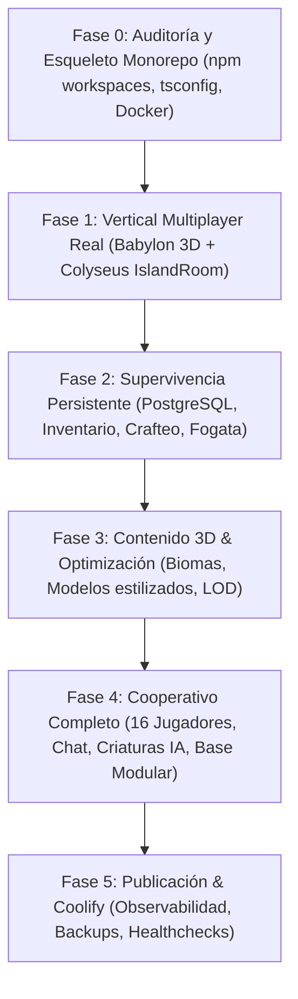

# PLAN DETALLADO DE IMPLEMENTACIÓN — WILDBORN ONLINE
## Hoja de Ruta Técnica, Dependencias, Riesgos y Criterios de Aceptación
**Versión del Documento:** 1.0.0 | **Fecha:** 22 de octubre de 2026 | **Estado:** En Ejecución

---

### 📌 Resumen de Fases y Dependencias

---

### 🚀 FASE 0: Auditoría y Esqueleto Monorepo
* **Objetivo:** Auditar y archivar la versión 2D previa, estructurar el monorepo con `npm workspaces`, configurar TypeScript en todos los paquetes, scripts de compilación, linters y Docker Compose base.
* **Tareas Concretas:**
  1. [x] Archivar código previo en rama `archive/godot-2d-myfamily` y tag `v0.9-godot-myfamily`.
  2. [ ] Crear `package.json` raíz con configuración de workspaces: `apps/*`, `packages/*`.
  3. [ ] Crear `packages/shared`: tipos comunes, mensajes de red, interfaces y constantes de juego.
  4. [ ] Crear `packages/game-content`: definición de items (madera, piedra, hacha, fogata) y recetas.
  5. [ ] Crear esqueleto de `apps/game-server` (Node.js, TypeScript, Colyseus).
  6. [ ] Crear esqueleto de `apps/api` (Node.js, TypeScript, Express/Prisma).
  7. [ ] Crear esqueleto de `apps/web` (Vite, React, TypeScript, Babylon.js).
  8. [ ] Crear `infra/compose.yml` y `infra/env.example` para Coolify.
* **Criterios de Aceptación:**
  - `npm run build` compila limpiamente todos los paquetes sin errores de TypeScript.
  - La estructura respeta 100% la arquitectura del PRD.

---

### 🎮 FASE 1: Vertical Multiplayer Real
* **Objetivo:** Escena 3D real en navegador y servidor autoritativo donde 2 jugadores en redes diferentes pueden verse mover en tiempo real.
* **Tareas Concretas:**
  1. **Servidor (`apps/game-server`):**
     - Crear `IslandRoom` en Colyseus con tick rate de 20 Hz.
     - Implementar `PlayerState` con esquema `@colyseus/schema` (x, y, z, rotación Y, animación actual, tick sequence).
     - Validación autoritativa de velocidad máxima (anti-speedhack) y límites geográficos de la isla.
     - Manejo de desconexión y reconexión con `allowReconnection(client, 15)`.
  2. **Cliente 3D (`apps/web`):**
     - Inicializar Engine y Scene de Babylon.js con WebGL2 / WebGPU fallback.
     - Crear terreno 3D estilizado de isla (playa de arena, pradera, elevación rocosa central, agua con shader animado, niebla ambiental y sol direccional).
     - Controlador de tercera persona:
       - Cámara orbital con mouse y Pointer Lock (`canvas.requestPointerLock()`).
       - Movimiento WASD, Sprint con Shift, Salto con Espacio.
     - Predicción cliente local e interpolación de entidades remotas (LERP suave para jugadores conectados).
     - Avatar estilizado 3D para el jugador local y jugadores remotos con nametag flotante 3D.
  3. **Conexión Multijugador:**
     - Menú de salas: Unirse o Crear Isla.
     - Conexión WSS al game-server.
* **Criterios de Aceptación:**
  - Dos pestañas o dispositivos distintos se conectan a la misma isla.
  - El jugador A ve moverse al jugador B en 3D con interpolación suave y rotación correcta.
  - El servidor valida la posición de ambos y rechaza teletransportes arbitrarios.

---

### 🪵 FASE 2: Supervivencia Persistente
* **Objetivo:** Bucle de supervivencia: recolección de madera/piedra, inventario de 20 casillas, crafteo de hacha y fogata, persistencia en PostgreSQL.
* **Tareas Concretas:**
  1. Modelo de base de datos PostgreSQL con Prisma (`users`, `characters`, `worlds`, `inventory_slots`, `structures`).
  2. Nodos de recursos recolectables en la isla (árboles talables, rocas picables) con cooldown y salud de recurso validada en servidor.
  3. Inventario de 20 espacios con apilamiento (stack limit) y persistencia atómica en BD.
  4. Recetas de crafteo (Hacha de piedra, Fogata).
  5. Sistema de colocación de estructuras en la isla (fogata con humo y luz cálida).
  6. Atributos de supervivencia (Salud 100, Hambre 100, Sed 100) que decrecen en el servidor.
* **Criterios de Aceptación:**
  - Recolectar un recurso descuenta el nodo para todos los jugadores.
  - Craftear una fogata consume los recursos exactamente una vez.
  - Al salir y reingresar, el inventario y la fogata permanecen intactos en la isla.

---

### 🎨 FASE 3: Contenido 3D & Optimización
* **Objetivo:** Dirección artística consistente, vegetación densa con Thin Instances, perfiles gráficos y optimización de rendimiento.
* **Tareas Concretas:**
  1. Integración de modelos glTF estilizados para herramientas, recursos y estructuras.
  2. Vegetación optimizada con Thin Instances de Babylon.js (miles de briznas de hierba y árboles con bajo conteo de draw calls).
  3. Selector de calidad gráfica en ajustes: Bajo (sin sombras), Medio (sombras suaves, 1080p), Alto (postprocesado cinematográfico).
* **Criterios de Aceptación:**
  - 60 FPS estables en hardware de gama media.
  - Memoria GPU controlada y sin fugas al reconectar.

---

### 👥 FASE 4: Cooperativo Completo
* **Objetivo:** Capacidad ampliada hasta 16 jugadores por sala, chat de texto por sala, fauna hostil con IA en servidor y construcción modular.
* **Tareas Concretas:**
  1. Chat de texto en tiempo real sincronizado por Colyseus.
  2. IA de criaturas del lado servidor (lobo/jabalí con máquina de estados: patrulla, persecución, ataque).
  3. Construcción modular (cimientos, paredes, puertas, techos).
  4. Pruebas de estrés con clientes sintéticos (bots).
* **Criterios de Aceptación:**
  - 16 jugadores interactuando en la misma isla sin desincronización crítica.
  - Criaturas dañan al jugador de forma autoritativa.

---

### 🚢 FASE 5: Publicación & Coolify
* **Objetivo:** Despliegue en producción con Docker Compose en Coolify, HTTPS/WSS, backups automáticos y healthchecks.
* **Tareas Concretas:**
  1. Dockerfiles multi-stage para `web`, `api` y `game-server`.
  2. Configuración de variables de entorno y secretos en Coolify.
  3. Pruebas de conexión real HTTPS y WSS con Traefik.
  4. Guía de recuperación ante desastres (`docs/DEPLOY_COOLIFY.md`).
* **Criterios de Aceptación:**
  - El juego está online en dominio HTTPS y se puede jugar desde cualquier parte del mundo.
